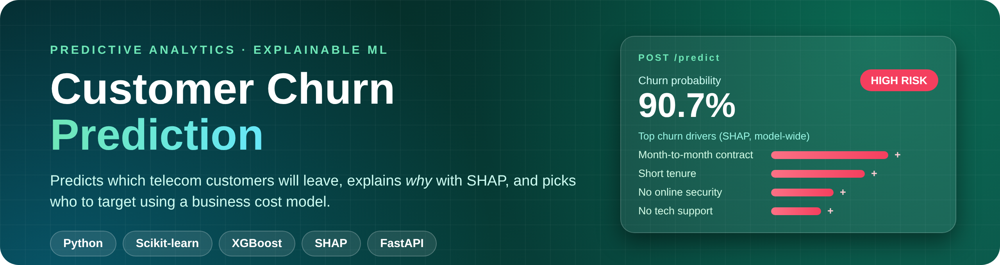
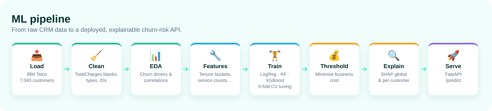
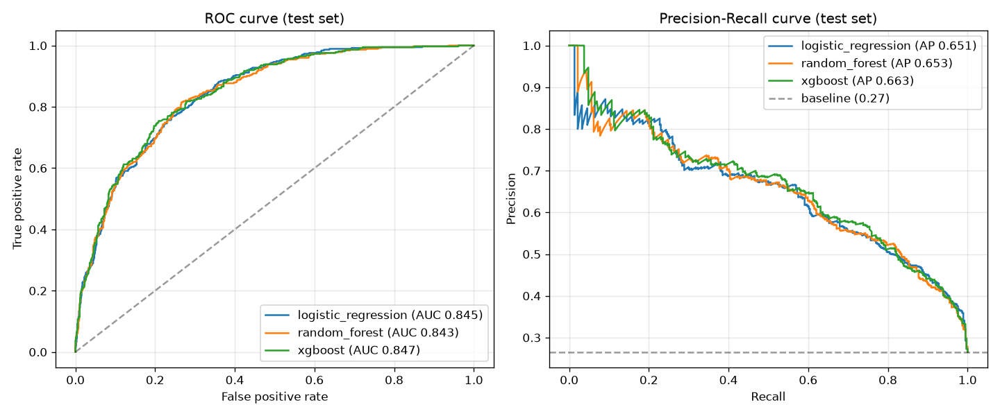
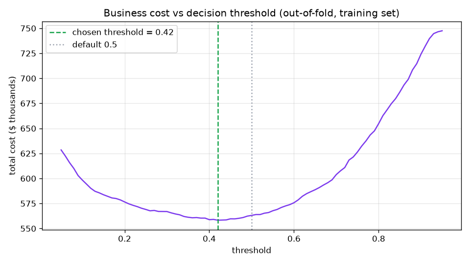
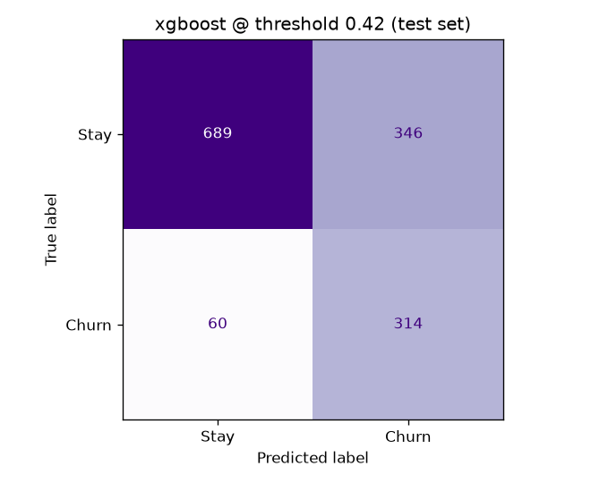
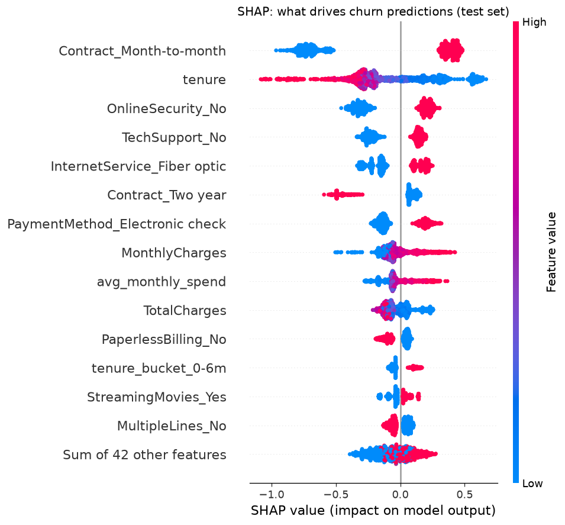
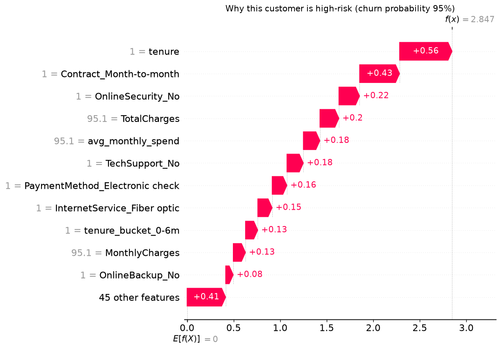

<p align="center">
  
</p>

<p align="center">
  
  
  
  
  
  
</p>

<p align="center">
  <b>End-to-end churn prediction for a telecom company: from raw CRM data to an explainable model,<br>a cost-based targeting decision and a REST API.</b>
</p>

---

## 📈 Results at a glance

<table align="center">
  <tr>
    <td align="center"><h2>0.847</h2>ROC-AUC</td>
    <td align="center"><h2>0.663</h2>PR-AUC<br><sub>(baseline 0.265)</sub></td>
    <td align="center"><h2>84%</h2>of churners caught<br><sub>at chosen threshold</sub></td>
    <td align="center"><h2>$45.5k</h2>cost saved on test set<br><sub>vs. no retention action*</sub></td>
  </tr>
</table>

<sub>*Under the stated business assumptions below, on 1,409 held-out customers.</sub>

## ✨ Highlights

| | |
|---|---|
| 🧹 **Data cleaning** | Found that `TotalCharges` is stored as text with 11 blanks, all for **tenure-0** customers, and filled them with 0 (not billed yet) instead of the mean. |
| 🔧 **Feature engineering** | Tenure buckets, number of services, average monthly spend, recent charge increase, family flag, auto-payment flag. |
| ⚖️ **Imbalance handling** | 26.5% churn rate: class weights / `scale_pos_weight`, stratified splits, **PR-AUC** as the selection metric instead of accuracy. |
| 🏋️ **Model comparison** | Logistic Regression baseline vs Random Forest vs XGBoost, each tuned with 5-fold `RandomizedSearchCV` inside a leak-free sklearn `Pipeline`. |
| 💰 **Business-driven threshold** | The decision threshold minimises the expected cost of retention offers vs lost customers, chosen on out-of-fold predictions only. |
| 🔍 **Explainability** | SHAP shows global churn drivers and explains individual predictions. |
| 🚀 **Deployment** | FastAPI `/predict` endpoint with Pydantic validation, plus pytest tests for the API and the cleaning logic. |

## 🔬 Pipeline

<p align="center">
  
</p>

## 💡 Key EDA insights

| Segment | Churn rate | vs. |
|---|---:|---|
| Month-to-month contract | **42.7%** | 2.8% on two-year contracts |
| First 6 months of tenure | **52.9%** | 9.5% after 4+ years |
| Electronic check payment | **45.3%** | overall average 26.5% |
| Fiber optic internet | **41.9%** | 19.0% on DSL |
| No tech support | **41.6%** | 15.2% with tech support |

Full analysis in [`notebooks/eda.ipynb`](notebooks/eda.ipynb).

## 🏆 Model performance (held-out test set, 1,409 customers)

Precision, recall and F1 below use the default 0.5 threshold; the cost-optimised threshold is covered in the next section.

| Model | CV PR-AUC | ROC-AUC | PR-AUC | Precision | Recall | F1 |
|-------|----------:|--------:|-------:|----------:|-------:|---:|
| Logistic Regression | 0.661 | 0.845 | 0.651 | 0.512 | 0.791 | 0.622 |
| Random Forest | 0.663 | 0.843 | 0.653 | 0.528 | 0.797 | 0.635 |
| 🥇 **XGBoost** | **0.666** | **0.847** | **0.663** | 0.513 | **0.802** | 0.626 |

<sub>Precision/recall/F1 at threshold 0.5. The best model is selected on <b>cross-validated</b> PR-AUC, not on the test set.</sub>

> **Honest take:** all three models land within 0.004 ROC-AUC of each other. On this dataset the signal is mostly captured by a few strong features (contract, tenure, services), so the well-regularised logistic regression is a very competitive baseline. In production its simplicity and interpretability could outweigh XGBoost's small gain.

<p align="center">
  
</p>

## 💰 From probabilities to a business decision

**Assumptions (illustrative, not from the dataset):** a retention offer costs **$50**, a lost customer costs **$500**, and the offer saves **50%** of real churners.

<table>
  <tr>
    <td width="58%"></td>
    <td width="42%"></td>
  </tr>
</table>

| Policy on the test set | Total cost |
|---|---:|
| No retention action | $187,000 |
| Target customers with p ≥ 0.50 | $141,250 |
| Target customers with p ≥ **0.42** (chosen on out-of-fold training predictions) | $141,500 |

At 0.42 the model catches **314 of 374 churners (84%)** and saves **$45.5k (24%)** versus doing nothing. The cost curve is flat between ~0.35 and ~0.55, so 0.42 and the default 0.5 perform almost the same on the test set. Class weighting already shifts the probabilities towards churn, which explains why the optimum ends up near 0.5.

## 🔍 Explainability with SHAP

<table>
  <tr>
    <td width="50%"></td>
    <td width="50%"></td>
  </tr>
  <tr>
    <td><b>Global:</b> month-to-month contracts, short tenure, no online security / tech support and fiber optic internet push churn risk up; two-year contracts push it down.</td>
    <td><b>Local:</b> the highest-risk test customer (95%) is a 1-month, month-to-month customer without security or tech support, paying by electronic check.</td>
  </tr>
</table>

## 🚀 Quick start

```bash
python -m venv .venv && source .venv/bin/activate
pip install -r requirements.txt

python -m src.train            # downloads data, tunes 3 models, writes reports/ and models/ (~1 min)
pytest -q                      # 6 tests: cleaning, features, API
uvicorn api:app --reload       # interactive docs at http://127.0.0.1:8000/docs
```

```bash
curl -X POST http://127.0.0.1:8000/predict -H "Content-Type: application/json" -d '{
  "gender": "Female", "SeniorCitizen": 0, "Partner": "No", "Dependents": "No", "tenure": 2,
  "PhoneService": "Yes", "MultipleLines": "No", "InternetService": "Fiber optic",
  "OnlineSecurity": "No", "OnlineBackup": "No", "DeviceProtection": "No", "TechSupport": "No",
  "StreamingTV": "Yes", "StreamingMovies": "Yes", "Contract": "Month-to-month",
  "PaperlessBilling": "Yes", "PaymentMethod": "Electronic check",
  "MonthlyCharges": 99.5, "TotalCharges": 199.0}'
# {"churn_probability":0.9071,"will_churn":true,"risk_level":"high","threshold":0.42}
```

## 📁 Project structure

```
customer-churn-prediction/
├── src/
│   ├── data.py          # download + cleaning
│   ├── features.py      # feature engineering + ColumnTransformer
│   └── train.py         # tuning, evaluation, cost threshold, SHAP, charts
├── api.py               # FastAPI service
├── notebooks/eda.ipynb  # exploratory data analysis
├── tests/               # pytest: cleaning, features, API
├── reports/             # charts, metrics.csv, business_metrics.json, metrics_log.jsonl
├── INTERVIEW.md         # interview questions & answers about this project
└── assets/              # README images
```

## 🗺️ Roadmap

- [ ] Probability calibration (isotonic / Platt) before applying the cost model
- [ ] Uplift modelling: target customers the offer can actually *persuade*, not just likely churners
- [ ] Survival analysis to predict *when* a customer will churn
- [ ] Docker image + monitoring for data drift

---

<sub>Dataset: <a href="https://github.com/IBM/telco-customer-churn-on-icp4d">IBM Telco Customer Churn</a> (7,043 customers).</sub>
